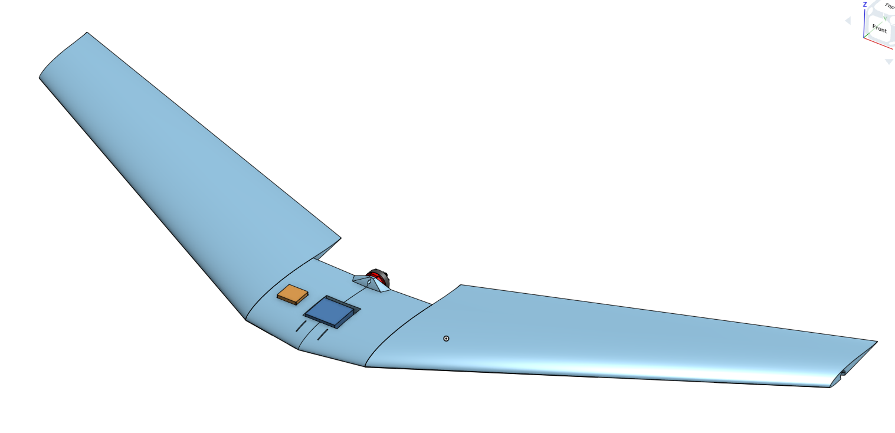

# My best flying wing yet

This is my custom designed FPV flying wing from scratch using my own wing manufacturing process and 3D printing

I am aiming to achieve 7A of cruise draw, while at 45kmph speed, i think hitting the speed record is gonna be one of the hard things in this challenge

The design is a conventional flying wing with a swept wing design, i gave 3 degrees of washout at wingtips, the design uses MH45 Airfoil for both root and tip chord

The root of the usable wing surface is 20cm and the tip is 10cm, sweep distance is 27cm with 98cm wingspan, so we can safely assume this is a 1000mm swept wing platform

I have confidence in this design as i studied why my old wings didnt fly and it was because the center of pressure of the wing was way too close to the COG and it didnt provide any stability of any sorts

# Tech stack

I will be using emax rs2205 motor for the main propulsion unit, with a 6045 triblade props that i have lying around

It will all be controlled by radiolink crossflight FC which will be flashed with INav or Ardupilot, I will then use Mavlink over ELRS to get telemetry to my laptop and this wing can be used to fly autonomous missions

I have a dakefpv 1W vtx connnected to a ms mini 1000tvl camera which will be responsible for broadcasting video to my gsc

## Heres the wiring diagram for the wing

# 3D printable files

the only files needed to be printed are the betterservolink and flyingwing3dpirnt files that are in CAD folder of the repo

# Wing build process

1. Cut out the templates of the airfoil out of cardboard
3. Use CA glue to reinforce the cardboard and stiffen it up
4. take a sheet of thermocol and on the side place the 2 templates you just cut out with nails or pins
5. wrap nichrome wire around 2 nails with approx 50cm distance between them attach the power wires on nails and power it using a powersupply (i used my old laptops 19V 2.5A supply)
6. slowly cut out the 45cm wing section out of the thermocol, dont worry if u dont nail it first try
7. Repeat this 1 more times to get total wing length of 90cm
10. Now cut your paper bag in approx 22.5cm sections
11. Cover a part of your wing with the mixture of craft glue + water and then place your piece of paper over it, make sure there are no airbubbles under the wing, do this for all around the wing
12. cut strips of 5cm and place it on the seams of the paper you laid down before
13. wait for your wing to completely dry before moving on

#After installing all the electroncis and stuff your assembly should look like this irl

# Onshape link
https://cad.onshape.com/documents/3d392902670710a880efa328/w/26a4caf5453043c9f88016e0/e/99eee52926858585e8632edb?renderMode=0&uiState=6ae2d6b02f8fe391dc6fb8cd
