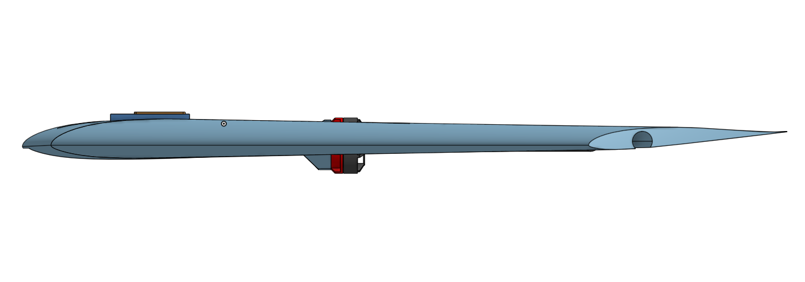
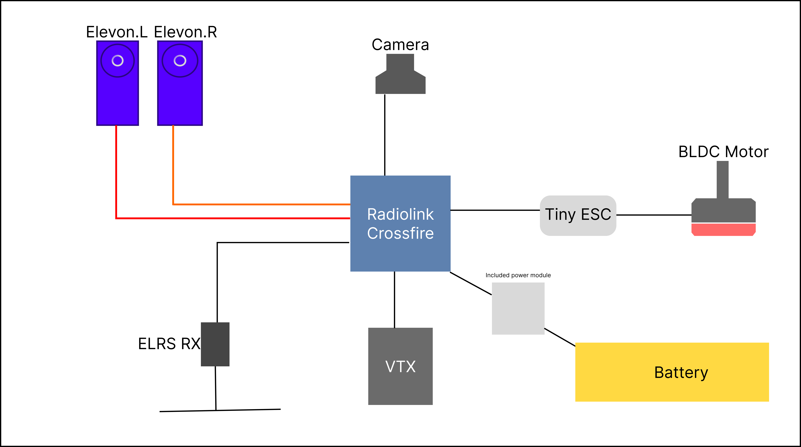

# My best flying wing yet

This is my custom designed FPV flying wing from scratch using my own wing manufacturing process and 3D printing

I am aiming to achieve 7A of cruise draw, while at 45kmph speed, i think hitting the speed record is gonna be one of the hard things in this challenge

The design is a conventional flying wing with a swept wing design, i gave 3 degrees of washout at wingtips, the design uses MH45 Airfoil for both root and tip chord

The root of the usable wing surface is 20cm and the tip is 10cm, sweep distance is 27cm with 98cm wingspan, so we can safely assume this is a 1000mm swept wing platform

I have confidence in this design as i studied why my old wings didnt fly and it was because the center of pressure of the wing was way too close to the COG and it didnt provide any stability of any sorts

# Tech stack

I will be using emax rs2205 motor for the main propulsion unit, with a 6045 triblade props that i have lying around

It will all be controlled by radiolink crossflight FC which will be flashed with INav or Ardupilot, I will then use Mavlink over ELRS to get telemetry to my laptop and this wing can be used to fly autonomous missions

I have a dakefpv 1W vtx connnected to a ms mini 1000tvl camera which will be responsible for broadcasting video to my gsc

## Heres the wiring diagram for the wing

